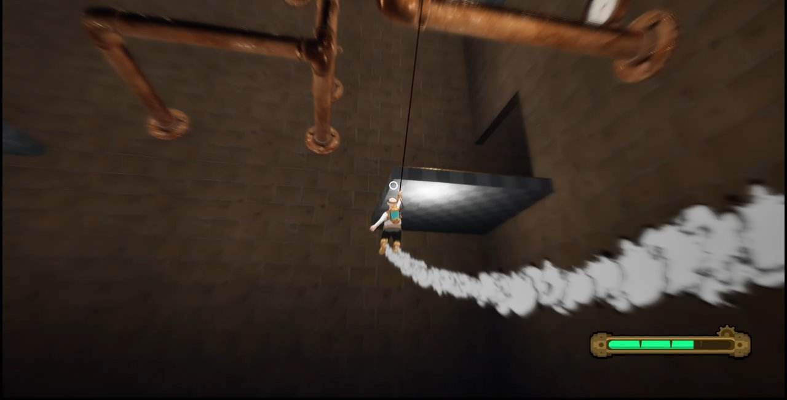

# Tension Up!

> 브릿지 2025-1 프로젝트 (2025.03 ~ 2025.08)

  

  

 

## 소개

케이블을 걸어 정상까지 오르는 물리 기반 3D 항아리 게임입니다.
주인공 벤은 케이블과 증기 부스터만으로 정상까지 올라가야 합니다.

 

## 주요 코드

| 파일 | 내용 |
|---|---|
| [CableActionComponent](Source/UncleWeb/Component/CableActionComponent.cpp) | 케이블 발사와 회수, 진자 운동 스윙 |
| [DynamicCamera](Source/UncleWeb/Component/DynamicCamera.cpp) | 속도에 따라 카메라 거리, FOV, 블러 조절 |
| [SteamComponent](Source/UncleWeb/Component/SteamComponent.cpp) | 증기 자원 소모와 회복 |
